<!-- BEGIN animated project showcase -->
<picture>
  <source media="(prefers-reduced-motion: reduce) and (max-width: 600px)" srcset=".github/showcase/still-terminal-overview-mobile.svg">
  <source media="(prefers-reduced-motion: reduce)" srcset=".github/showcase/still-terminal-overview.svg">
  <source media="(max-width: 600px)" srcset=".github/showcase/terminal-overview-mobile.svg">
  
</picture>
<!-- END animated project showcase -->

Hello GitHub
